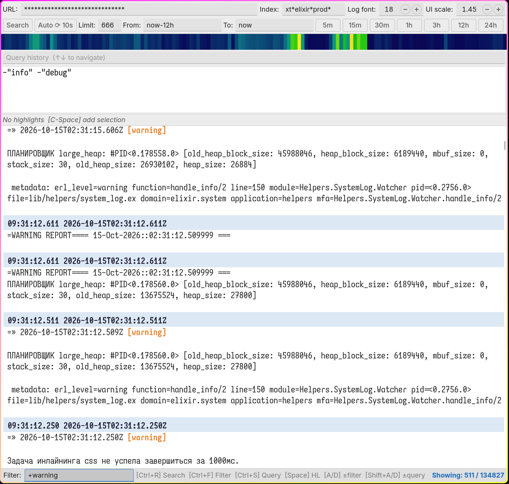

~~ Who is this for? ~~

Are you fed up waiting for Kibana to open just to check one error?
Does its crappy UI annoy you?
Does searching through logs take forever?"

If you are tired of stupid kibana. Use ELVPUC. Life is good, enjoy.

Props:
+ All field save beetwen restarts
+ ~20mb memory usage (less than one button in kibana UI)
+ Open instantly
+ Use ancient technology

Cons:
- I don't care

Features:
+ Heatmap of hits over time. Click bar to zoom in, mouse wheel to make zoom wider/narrower
+ Time presets 5m / 15m / 30m / 1h / 3h / 12h / 24h, one click
+ Auto ⟳ refresh, for those who like to stare at logs
+ Offline filter `+word` / `-word` / `word` (ANDed). Filters faster than HTTP request finishes TLS handshake
+ Highlight any word with own random color, as many as you want
+ Show full record with all fields (JSON), Esc to close

Hotkeys:

| Key | Action |
|---|---|
| `Ctrl+R` / `F5` | Search |
| `Ctrl+Enter` | Search (from Query field) |
| `Ctrl+F` | Focus Filter |
| `Ctrl+S` | Focus Query |
| `Ctrl+Space` | Toggle highlight on selection |
| `A` / `D` | Add `+selection` / `-selection` to offline filter |
| `Shift+A` / `Shift+D` | Add `+"selection"` / `-"selection"` to Lucene query |
| `Alt+U/I/S/L/F/T` | Focus URL / Index / Search / Limit / From / To |
| `V` | Show full record under text cursor (focus in log) |
| `Esc` | Close full record window |

Right click (on log):
+ `+ filter` / `− filter` — same as `A` / `D`
+ `+ query` / `− query` — same as `Shift+A` / `Shift+D`
+ `Toggle highlight` — same as `Ctrl+Space`
+ `Show all fields` — full record under cursor, all fields. Same as `V`

Usage:

```
git clone https://github.com/demoj1/elvpuc.git && cd elvpuc && python3 main.py
```

After usage check config path: `~/.config/elk_config`

---


